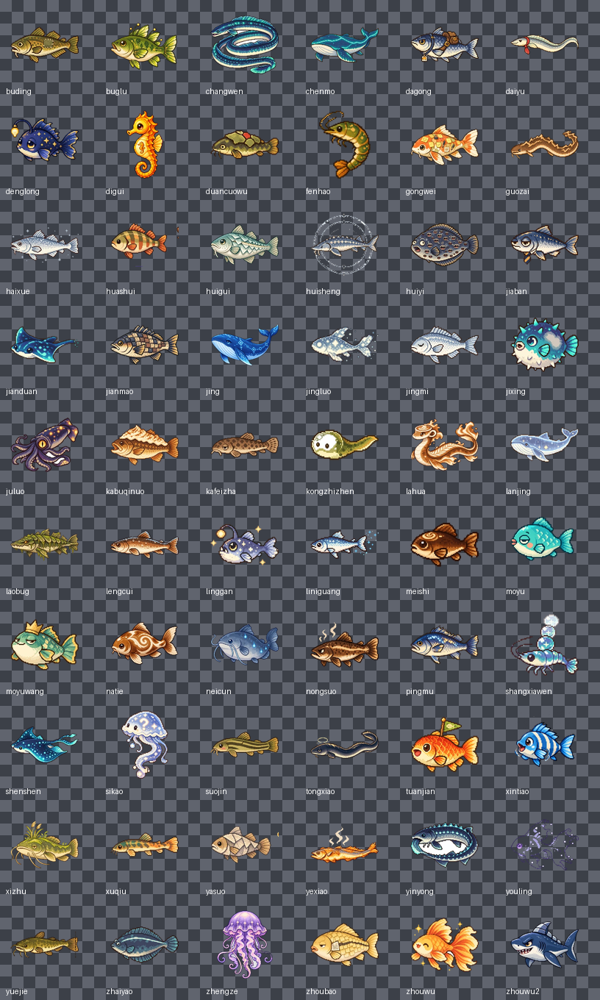

# 摸鱼塘 · dsh-moyutang

> 边写代码边钓鱼。你和 Agent 对话消耗的 Token 会自动变成鱼饵积分，积分可以在左侧边栏的鱼塘里抛竿；钓到的鱼点亮图鉴、卖金币、买装备、解锁新鱼塘。

按策划案《DSH 插件策划 · 娱乐类 · 摸鱼塘 v1.0》实现，落地为 DeepSeek Harness 的一个本地插件包：

- **左侧图标列表**多了一个「摸鱼塘」图标（`sidebar.panellist`），点开是中央面板（`main`）。
- **Host 半**只统计 Token 用量，不读对话内容；**Client 半**是全部游戏逻辑与界面。
- 存档在浏览器 localStorage，Token 计数在 `~/.dsh/moyutang/metrics.json`，没有任何外部网络请求。

## 打开方式

侧边栏图标列表里第三个图标（在「插件」「日程」之后），点击即打开鱼塘面板。首次打开建议刷新一次页面，确保加载的是最新版客户端代码。

## 分享给别人

三种方式，按"对方要做什么"选：

### A. 发一个 zip（最省事，推荐）

```powershell
pwsh -NoProfile -File tools\pack.ps1
# → dist\dsh-moyutang-1.0.0.zip（96 个文件，1.7 MB，只含运行期文件）
```

对方解压到任意目录，然后在自己的 DSH 里对 Agent 说「把 `<路径>` 作为本地插件包安装并启用」，刷新页面即可。zip 里附了面向对方的 [INSTALL.md](INSTALL.md)（环境要求、安装、玩法、数据位置、排错）。

`tools/pack.ps1` 只会收 `package.json / index.js / client.js / cordis.patch.yml / icon.svg / README.md / INSTALL.md / locale / assets{fish,items,ponds}`；`assets/raw`、`assets/gen`、`tools/`、截图都不会进包。`tools/verify_pack.mjs` 会检查打包结果：包名与 client 模块 id、patch 行名是否一致，60/21/6 张图是否齐全，有没有把工作文件漏进去。

### B. 开源仓库（适合迭代和 PR）

仓库就在 <https://github.com/huodesheng/moyutang>。对方可以用 pnpm 支持的 git 规格安装：

> 把 `github:huodesheng/moyutang` 作为插件包安装并启用

注意 git 安装会拉整个仓库（`files` 字段不生效），所以别把 `assets/raw`、`assets/gen`（约 88 MB 源料）提交进去——`.gitignore` 已经排掉了，另外 `tools/private/` 里放的是作者侧的一次性脚本。

### C. 发布到 npm（对方一行就能装）

发布前**必须改名**：`@local/dsh-moyutang` 里的 `@local` 不是你自己的 scope，npm 会拒绝。改成不带 scope 的 `dsh-moyutang`，或你自己的 `@<scope>/dsh-moyutang`。

改名要同时改三处（它们必须一致，否则客户端模块加载不上）：

1. `package.json` → `name`
2. `cordis.patch.yml` → `- insert: - name:`
3. `client.js` → `window.__ModuleLoader__.load({ id: ... })`

然后：

```bash
npm publish --access public     # 带 scope 时必须加 --access public
```

对方在 `设置 → 插件 → 添加` 里填包名即可，或者对 Agent 说「安装 dsh-moyutang 这个插件」。

需要我直接准备一版改好名、可直接 `npm publish` 的目录，告诉我包名就行（我可以把改名做在 `dist/publish/` 里，不动现在这份正在运行的安装）。

当前已在作者的 `desktop` profile 安装并启用（把本仓库目录作为本地 bundle 链接进去，路径因人而异）：

```
@local/dsh-moyutang 1.0.0   source: link:<本仓库目录>
```

重新安装/升级：用 DSH 的插件管理把本仓库目录（即插件包根目录）作为本地 bundle 安装即可；`cordis.patch.yml` 会插入 `moyutang` 这一行。

## 玩法

### 资源链

| 环节 | 输入 | 产出 |
| --- | --- | --- |
| 用 DSH 干活 | 对话 Token | 鱼饵积分 |
| 抛竿钓鱼 | 积分 | 鱼、杂物、宝箱、随机事件 |
| 点亮图鉴 | 首次钓到的鱼种 | 图鉴条目、尺寸纪录 |
| 卖鱼换钱 | 鱼（稀有度 / 尺寸 / 品相） | 金币 |
| 消费与成长 | 金币 | 鱼竿、鱼饵、浮漂、装饰、新鱼塘 |

### 一次钓鱼

1. **蓄力抛竿**：按住按钮，力度指示来回摆动，松手锁定。力度越大，远处稀有鱼概率越高。
2. **等待咬钩**：浮漂 3–9 秒内出现咬钩；之前的「假动作」会骗走手快的玩家。真咬钩有 0.9 秒窗口（夜光浮漂 +0.38 秒）。
3. **张力收线**：按住收线张力上升、松手放线下降；张力保持在蓝色区间时进度增长。鱼会随机冲刺，张力过高断线。Boss 需要连续完成 3 个回合。
4. **鱼卡结算**：显示鱼名、稀有度、尺寸、品相、是否新图鉴、是否破纪录，可选放入鱼篓 / 立即卖出 / 放生（积累鱼塘好感）。

### 抛竿与咬钩动画

场景是像素画，鱼竿和浮漂都是画在里面的，所以动画全部叠在画面上、并按每个塘实测的锚点对齐：

- **蓄力**：力度条来回摆动，水面目标点出现白色虚线光圈，告诉你这一竿会落在哪。
- **抛竿**（约 0.6–0.8 秒，力度越小飞得越久）：浮漂从竿尖（新手溪 48%/17%、咖啡因湖 52%/46%）或画面左下沿的「胸前竿」飞出，走一条抛物线，鱼线用二次贝塞尔曲线实时跟随并带一点下垂。
- **落水**：三圈涟漪由小到大扩散淡出，随后浮漂进入轻微上下浮动。
- **假动作**：浮漂快速下沉 0.26 秒再弹回，骗你提前提竿。
- **咬钩**：浮漂猛地扎进水里并左右抖动、涟漪再起、浮漂上方弹出红色「咬钩！」气泡、整个画面轻微抖动，按钮同时变红闪烁。
- **收线**：浮漂被一点点拉向竿尖，边拉边抖。

全部由同一个 `requestAnimationFrame` 循环算位置（不靠 CSS keyframes 拼接），所以浮漂、鱼线、涟漪永远同步；`prefers-reduced-motion` 与设置里的「减弱动画」会关掉抖动和持续动画。

### 稀有度

| 稀有度 | 基础概率 | 卖价（金币） | 表现 |
| --- | --- | --- | --- |
| 普通 N | 60% | 5–15 | 灰白鱼卡 |
| 优良 R | 25% | 20–50 | 蓝色鱼卡 |
| 稀有 SR | 11% | 80–200 | 紫色鱼卡 |
| 史诗 SSR | 3.5% | 300–800 | 金色鱼卡 |
| 传说 UR | 0.5% | 不可卖 | 仅收藏、Boss |

另有尺寸（影响卖价与纪录）、品相（普通 / 肥美 ×1.5 / 闪光 ×2，闪光概率 1/200）、连续 10 竿未出 SR 以上的保底。

### 六个鱼塘 · 60 种鱼 · 6 条 Boss

新手摸鱼溪（默认）→ 咖啡因湖 → Bug 沼泽 → 加班夜海（19:00 后开放）→ 上下文深渊（需要深潜值）→ 深度求索鲸落（终局）。
每个鱼塘 10 种鱼：N×3、R×3、SR×2、SSR×1、Boss（UR）×1，含「404 幽灵鱼」「递归海马」「上下文压缩鳕」「凌晨三点的灵感鱼」「深度求索鲸」等策划案里的条目。



（图里是全部 60 条鱼的透明贴图，深色棋盘格只是为了看清边缘。素材来源与生成方式见下文「美术素材怎么来的」。）

### 联动机制

- **会话天气**：Host 半统计 5 分钟内 ≥2 次工具报错 → 雷雨；雷雨中 Bug 鲈出现率翻倍，水面变暗。
- **昼夜**：清晨 / 白天 / 黄昏 / 深夜，部分鱼只在特定时段出现（拿铁锦鲤清晨、屏幕光鲷深夜、灵感鱼 03:00–04:00 隐藏条目）。
- **深潜**：Agent 今天思考越久（reasoning 时长；provider 不上报时用今日有效 Token 折算）深潜值越高，上下文深渊需要 ≥5% 才能下钩。
- **挂机钓鱼**：输入框下方的状态条上有「挂机钓鱼」开关（就在 Token 统计旁边）。勾上后每 12 秒自动抛竿一次（成功率 60%），**切到对话、关掉鱼塘面板也继续钓**，状态条实时显示「挂机中 · 鱼塘 · 已钓 N 条 · 空军 M」，钓到的鱼直接进鱼篓。每竿照常扣积分，鱼塘取「最后选择的那个」。
- **股市波动**：每天两种鱼热卖 ×2、一种滞销 ×0.5，买卖节奏随日期变化。

### 图鉴 / 商城 / 委托 / 成就

- **图鉴**：未获得显示剪影 + 谜语提示；获得后显示像素鱼、出没条件、最大尺寸纪录、捕获次数、首次捕获时间。按鱼塘分组并显示点亮进度。
- **商城**：4 种鱼竿（张力容错）、3 种浮漂/线（咬钩窗口、断线阈值）、4 种鱼饵（定向加成）、4 种纯外观装饰（会在鱼塘岸边出现）。
- **每日委托**：每天从 7 个模板里固定抽 3 个（抛竿 / 收获 / 稀有 / 卖鱼 / 雷雨 / 鱼种数 / 闪光），完成后领金币。
- **成就**：空军大师、报错驯鱼师、凌晨三点见证者、第一个 Boss、图鉴过半、见过鲸的人。
- **设置**：挂机开关、减弱动画、存档导出/导入/重置、数据源状态、离线时的体验模式结算。

## Token → 鱼饵积分

```
有效 Token = 输出 Token × 1.0 + 未命中缓存的输入 × 0.2 + 缓存 Token × 0.05
鱼饵积分   = 有效 Token ÷ 1000 × 连续天数倍率
```

- **每日软上限**：0–300 积分全额，300–600 按 50%，600 以上按 10%，本地 0 点重置。
- **连续摸鱼**：连续使用每天 +5% 倍率，上限 +30%。
- **完成奖励**：一轮任务无报错结束额外 +1 积分。
- **新手礼包**：首次打开赠送 40 积分 + 200 金币，方便立刻试玩。

Host 半只累加每次 `assistant/message` 的 `usage`（input / output / cacheRead / cacheWrite / reasoning）与 `turn/end` 的结果、`tool/result` 是否报错，**不读取消息正文**。

## 技术结构

```
package.json          包清单：dsh.bundle.patch + dsh.client(web) + exports + files
cordis.patch.yml      插入 Host 行 moyutang
index.js              Host 半：计量 Token、落盘 metrics.json、同源提供美术资源
client.js             Client 半：注册 sidebar.panellist 图标与 main 面板、全部游戏逻辑与 UI
locale/en.json        插件显示名与描述（英文）
locale/zh-CN.json     插件显示名与描述（中文）
icon.svg              原创图标（鱼 + 浮漂 + 水面）
assets/ponds/*.webp   6 张鱼塘场景（1280x720）
assets/fish/*.webp    60 条鱼的透明贴图（256x256）
assets/items/*.webp   21 个道具/装备图标（128x128）
assets/raw/           从 docx 抽出的原始图（不打包）
assets/gen/           接口生成的原始 PNG（不打包）
assets/prompts/fish.json  生成鱼贴图用的提示词清单
tools/                数值测试、渲染测试、素材处理与生图脚本
```

- **槽位**：`ctx.slots.inject('sidebar.panellist', ...)` 注册 `id: moyutang` 的图标，`ctx.slots.inject('main', ...)` 注册 `key: moyutang` 的面板；点击图标由侧边栏切换面板。另外 `conversation.composer.dock` 槽位注册了 `id: moyutang-auto` 的挂机条，排在 Token 统计之后。
- **一份存档、一个轮询**：游戏状态（`gameStore`）与 Token 计量（`metricsState`）都是模块级单例，面板与挂机条订阅同一条状态流；积分结算写在计量轮询里，所以只开着对话、不打开鱼塘面板，鱼饵也照涨。挂机计时器同样是模块级、按引用计数启停，两个入口同时打开也只有一个计时器。
- **状态机**：蓄力 → 等待咬钩 → 张力收线 → 鱼卡，全部由单个 `requestAnimationFrame` 循环驱动；随机数、概率表、价格、软上限都是纯函数。
- **存档**：`localStorage["dsh.moyutang.save.v1"]`，带版本号字段、按天重置、支持导出/导入；跨标签页同步。
- **美术资源**：Host 半按 `GET /moyutang-api/assets` 列出清单、按 `GET /moyutang-api/asset/<fish|items|ponds>/<id>.webp` 同源返回（带 ETag 与 24h 缓存，拒绝目录穿越）。Client 半拿到清单后把图铺到鱼塘场景、图鉴、鱼卡、鱼篓与商城；缺图时自动回退到内置的像素鱼 SVG。
- **样式**：只使用 `--dsw-alias-*` 主题 token（水面/鱼/装饰是美术色），`mt-` 前缀，无第三方依赖，不使用任何 Harness Client 包。
- **容错**：面板外包一层 ErrorBoundary，出错时显示错误与「重试」，不会把槽位渲染成空白。

### 美术素材怎么来的

- **鱼塘场景 6 张、鱼贴图 12 条、道具 6 个**：来自策划案文档里的 27 张图（另有 3 张是索引图，仅作对照）。`tools/build_assets.py` 负责裁切 16:9 场景、把棋盘格/奶油底抠成透明、裁到内容边界后缩放成 WebP。
- **其余 46 条鱼**：用文档里给的异步生图接口（BaseURL `https://api.goeasyapi.xyz`，模型 `gpt-image-2-async`，`1024x1024`）按 `assets/prompts/fish.json` 的提示词批量生成，`tools/gen_fish.py` 三个并发跑完，`tools/process_gen.py` 抠白底后产出透明 WebP。Key 只放在 `%TEMP%\moyutang-goeasy-key.txt`，没有进仓库。
- 想换风格或补图：改 `assets/prompts/fish.json` 里某条鱼的 `visual`，重跑 `gen_fish.py`（已有的会跳过，删掉 `assets/gen/<id>.png` 即可重生）再跑 `process_gen.py`；场景图直接替换 `assets/raw` 里对应文件后跑 `build_assets.py`。

### 数值参数在哪

`client.js` 顶部的 `BALANCE`（软上限、倍率、闪光概率、保底、张力/进度速度、自动钓鱼间隔）、`RARITY`（概率与价格区间）、`PONDS`（解锁条件与每竿消耗）、`FISH_RAW`（鱼种数据）、`RODS / BAITS / LINES / DECOR`（商品）。改这些不需要动逻辑。

### 积分结算的两个坑（已修）

- **基线必须落盘**：`creditFromMetrics` 首次同步要把 `seenTotal` 基线写进存档。之前它返回 `false` 让 `act()` 丢弃了 draft，于是每 5 秒重新把基线设成当前总量，`delta` 永远是 0——积分永远不涨。现在首次同步从 0 起算并**返回 true**，Host 已记录的 Token 会按当日软上限一次性补发，之后只结算增量。
- **监听器要能自愈**：Host 的 `session/event` 监听器曾经在插件热重载后失效（路由还活着，计数却停了）。现在监听器包在 `ctx.effect` 里，由 `ctx.on('llm/stream')` 提供"确实有模型调用"的信号，看门狗每 30 秒检查一次：如果模型调用发生了 4 分钟却没有任何会话事件，就重新挂载监听器（先 dispose 再注册，不会重复计数）。`GET /moyutang-api/state` 的 `debug` 字段会返回 `eventsSeen / lastEventAt / lastModelCallAt / reattaches`，设置页也直接显示「Host 最近一次收到会话事件」和重连次数。

## 隐私

- 只读取 Token 数量与会话状态（回合结束原因、工具是否报错），**不读取、不存储对话正文**。
- 不向模型注入任何内容、不调用模型，零额外 Token。
- 运行时不访问外部网络：美术图由本机 Host 半以同源路由提供。数据只写本机两处：
  - `~/.dsh/moyutang/metrics.json`（Host 计量，可用 `DSH_MOYUTANG_DIR` 改目录）
  - 浏览器 localStorage（游戏存档）
- 源码与素材全部在本目录，可逐行核对。

## 与策划案的差异（尚未实现）

已实现策划案的主线：Token→积分、软上限/倍率/完成奖励、抛竿/咬钩/张力、稀有度/品相/闪光/保底、六个鱼塘与 Boss、60 种鱼图鉴、卖鱼与金币商城、每日委托、成就、天气/昼夜/深潜/挂机、存档导出导入、静音与减弱动画。

暂未实现（策划案里属于 V1–V3 的扩展）：水族箱陈列、老板巡视事件、钓鱼日记分享卡、季节/节日限定鱼、宠物猫助手、桌宠联动、好友鱼塘/排行榜、音效、单轮 Token 异常的“观察期”延后发放（软上限已覆盖刷量风险）。

## 验证记录

- `node --check index.js / client.js` 通过；`tools/check-keys.mjs` 文案键 103/103，中英对齐。
- `tools/logic-test.mjs`：60 种鱼/6 塘/6 Boss、稀有度分布、保底、隐藏鱼时段、价格与品相、软上限分段、连击倍率、跨日重置、委托进度、解锁条件、捕获记账 —— 全部通过。
- `tools/smoke-render.mjs`：图标（选中/未选中）与六个分页（鱼塘/图鉴/商城/鱼篓/委托/设置）渲染无异常。
- `tools/smoke-assets.mjs`：有图时渲染 ``、锁定的鱼仍用剪影、缺图回退 SVG、道具图标、鱼塘场景走美术层/回退 CSS 场景 —— 全部通过。
- 已安装并在当前 Web GUI 生效：`sidebar.panellist:moyutang`、`main:moyutang` 两个槽位均为 active；`GET /moyutang-api/state` 返回真实 Token 统计（写入 `~/.dsh/moyutang/metrics.json`）；`GET /moyutang-api/assets` 返回 60 鱼 / 21 道具 / 6 场景，`/moyutang-api/asset/...` 返回 `image/webp` 且目录穿越请求被 404 拒绝。
- 视觉外观未做截图验证（当前会话没有浏览器控制）；面板有 ErrorBoundary，出问题会显示错误与「重试」，开发者控制台里以 `[moyutang]` 开头的日志会指出原因。
